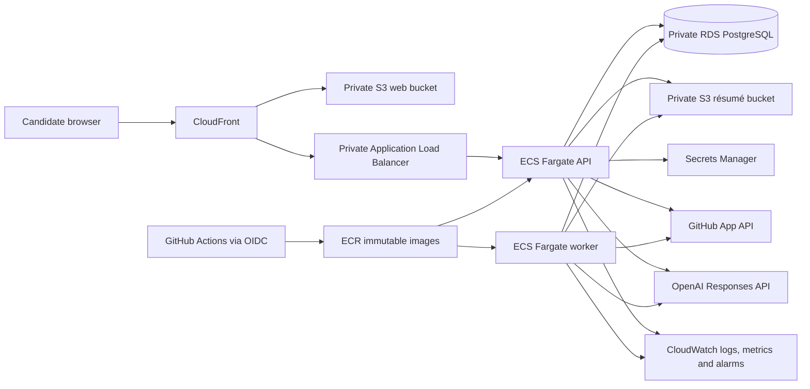

# Production architecture

The browser uses secure cookies and CSRF tokens. Résumés stay in a private bucket. The worker consumes durable PostgreSQL jobs, so API restarts do not lose analysis work. Production secrets are injected at runtime and never committed. OpenTelemetry instrumentation can export traces and metrics through an approved OTLP collector; CloudWatch container insights, structured logs, health checks, and a 5xx alarm form the baseline.

The supplied application stack accepts existing network, database, bucket, secret, and narrowly scoped IAM role identifiers. This separation prevents a repository workflow from creating its own administrator role.

## Network and internal TLS decision

Staging deliberately keeps ECS tasks in public subnets with public IPv4 egress because the Worker and API call GitHub and OpenAI and the project does not yet pay for redundant NAT gateways. The task security group accepts inbound traffic only from the private ALB, so the public addresses are egress-only from the application's perspective. The ALB itself remains internal in isolated subnets and is reachable only through the CloudFront origin-facing managed prefix list plus the origin-verification header.

Production must not reuse that compromise. It will place ECS tasks in private workload subnets with `AssignPublicIp=DISABLED`, use redundant NAT egress for third-party APIs, and add VPC endpoints for ECR, S3, CloudWatch Logs and Secrets Manager. CloudFront-to-origin TLS will use an ACM certificate and a reviewed origin hostname on the internal ALB; `https-only` will replace the staging VPC origin's `http-only`. A production domain/certificate and the recurring NAT/ACM-related cost are prerequisites, so the repository intentionally does not pretend that the current staging listener is production TLS.
